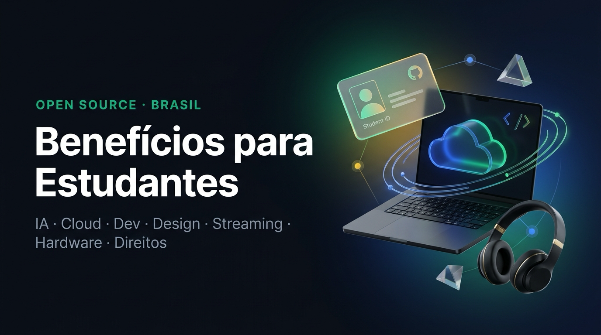
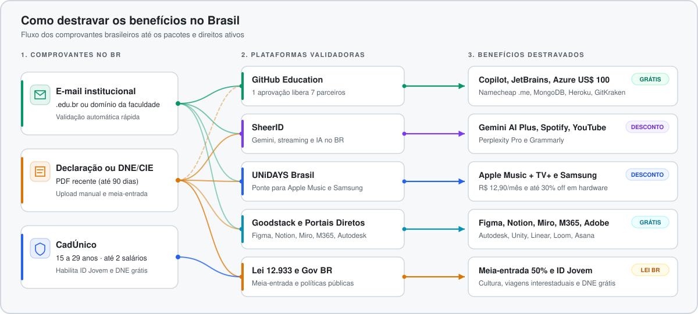

  

# Benefícios para Estudantes no Brasil

> Lista curada de benefícios, planos gratuitos, descontos e direitos para estudantes universitários, técnicos e do ensino médio no Brasil: IA, programação, cloud, design, produtividade, streaming, hardware e meia-entrada verificados para quem estuda no BR.

Última curadoria: 2026-11-24 · Mantenedor: [Tiago Vilas Boas](https://github.com/tiagovilasboas)

[Por onde começar](#por-onde-começar) · [GitHub Pack](#o-que-já-vem-no-github-student-pack) · [IA, Cloud e Dev](#quais-benefícios-de-ia-cloud-e-dev-funcionam-no-brasil) · [Design e Produtividade](#quais-ferramentas-de-design-e-produtividade-têm-plano-estudante) · [Streaming e Hardware](#quais-descontos-de-streaming-e-hardware-valem-no-brasil) · [Cursos e Direitos](#quais-cursos-e-direitos-existem-no-brasil) · [Fora da lista](#o-que-este-repositório-não-inclui) · [Contribuir](#como-contribuir)

| Categoria | Exemplos principais | Validação típica no BR | Seção |
|---|---|---|---|
| GitHub Student Pack | Copilot, JetBrains, Azure, domínio `.me`, MongoDB | E-mail `.edu.br` ou matrícula no GitHub | [GitHub Pack](#o-que-já-vem-no-github-student-pack) |
| IA, Cloud e Dev | Gemini, Perplexity, Raycast, Autodesk, Unity | SheerID, e-mail institucional ou matrícula | [IA, Cloud e Dev](#quais-benefícios-de-ia-cloud-e-dev-funcionam-no-brasil) |
| Design e Produtividade | Figma, Notion, Miro, Microsoft 365, Adobe | E-mail institucional, Goodstack ou matrícula | [Design e Produtividade](#quais-ferramentas-de-design-e-produtividade-têm-plano-estudante) |
| Streaming, Hardware e Direitos | Spotify, Apple Music, Samsung, DNE/CIE, ID Jovem | SheerID, UNiDAYS, DNE/CIE ou CadÚnico | [Streaming](#quais-descontos-de-streaming-e-hardware-valem-no-brasil) e [Direitos](#quais-cursos-e-direitos-existem-no-brasil) |

## Por onde começar

1. **Separe seus comprovantes:** e-mail institucional (`.edu.br` ou domínio da faculdade), declaração de matrícula recente em PDF e DNE/CIE. Veja o passo a passo em [docs/validacao-brasil.md](docs/validacao-brasil.md).
2. **Ative o GitHub Student Pack primeiro:** uma única aprovação libera Copilot, IDEs da JetBrains, créditos Azure, domínio e bancos de dados.
3. **Configure o UNiDAYS e deixe o comprovante pronto para o SheerID:** essas duas validações destravam Apple Music, Samsung Estudantes, Spotify, YouTube Premium e Perplexity.
4. **Resgate os planos avulsos de maior retorno:** Gemini, Figma Education, Notion Education e Microsoft 365 Education.

<picture>
  <source media="(prefers-color-scheme: dark)" srcset="assets/mapa-ecossistema-dark.svg">
  <source media="(prefers-color-scheme: light)" srcset="assets/mapa-ecossistema-light.svg">
  
</picture>

Checklist rápido de resgate (copie para suas notas)

- [ ] GitHub Student Developer Pack (Copilot e GitHub Pro)
- [ ] IDEs da JetBrains (via GitHub Pack ou e-mail institucional)
- [ ] Microsoft Azure for Students (US$ 100 sem cartão)
- [ ] Google Gemini / AI Plus (1 ano grátis; agendar cancelamento antes de renovar)
- [ ] Figma Education (plano Professional gratuito)
- [ ] Notion Education (plano Plus com e-mail da faculdade)
- [ ] Microsoft 365 Education (Office e OneDrive via instituição)
- [ ] UNiDAYS Brasil (ponte para Samsung Estudantes e Apple Music)
- [ ] Spotify Universitário, Apple Music ou YouTube Premium Estudante
- [ ] DNE/CIE para meia-entrada ou ID Jovem (CadÚnico)

## O que já vem no GitHub Student Pack

> [!TIP]
> Uma única aprovação no GitHub Student Developer Pack libera todos os 7 parceiros abaixo sem precisar revalidar a carteirinha em cada plataforma. A DigitalOcean deixou o pacote.

| Serviço | Benefício no Brasil | Como validar | Observação | Link |
|---|---|---|---|---|
| GitHub Pro, Copilot e Codespaces | GitHub Pro, Copilot completo e horas de Codespaces grátis | GitHub Education | Válido enquanto durar o vínculo estudantil | [GitHub Education](https://education.github.com/pack) |
| IDEs da JetBrains | Acesso completo a IntelliJ, PyCharm, WebStorm, GoLand e outras | GitHub Pack ou e-mail institucional | Renovação anual gratuita para uso educacional | [JetBrains Education](https://www.jetbrains.com/community/education/) |
| Microsoft Azure for Students | US$ 100 em créditos de nuvem e serviços gratuitos | E-mail institucional ou GitHub Pack | Não exige cartão de crédito; requer 18+ anos | [Azure Students](https://azure.microsoft.com/pt-br/free/students/) |
| Namecheap | Registro de domínio `.me` ou `.tech` e SSL grátis por 1 ano | GitHub Student Pack | Cuidado com a renovação paga no segundo ano | [Namecheap Education](https://nc.me/) |
| MongoDB Atlas | Créditos para clusters na nuvem e certificações | GitHub Student Pack | Ideal para protótipos e projetos acadêmicos | [MongoDB Students](https://www.mongodb.com/students) |
| Heroku | Créditos de plataforma para hospedagem de apps | GitHub Student Pack | Resgate direto pelo painel do Pack | [Heroku Students](https://www.heroku.com/github-students) |
| GitKraken Pro | Licença Pro gratuita para cliente Git e ferramentas | GitHub Student Pack | Vinculação direta com a conta GitHub | [GitKraken Pack](https://www.gitkraken.com/github-student-developer-pack) |

## Quais benefícios de IA, cloud e dev funcionam no Brasil?

Planos de inteligência artificial, engenharia, segurança ofensiva e plataformas em nuvem com oferta estudantil ativa no Brasil.

> [!IMPORTANT]
> Alguns benefícios pedem cartão de crédito no resgate e cobram tarifa cheia após o período gratuito: o Google Gemini AI Plus passa a cobrar R$ 24,99/mês depois de 1 ano se não cancelar, e domínios da Namecheap renovam pagos no segundo ano.

| Serviço | Benefício no Brasil | Como validar | Observação | Link |
|---|---|---|---|---|
| Google Gemini (Google AI Plus) | 1 ano grátis do plano AI Plus para universitários 18+ | SheerID / Google One | Resgate até 31/12/2026; exige cartão e cobra R$ 24,99/mês após 1 ano se não cancelar (nos EUA é AI Pro) | [Gemini Students BR](https://gemini.google/br/students) |
| Perplexity Pro | Desconto estudantil no plano Education Pro (~US$ 10/mês) | SheerID | Inclui buscas avançadas e Deep Research no BR | [Perplexity Students](https://www.perplexity.ai/students) |
| Raycast Pro | 50% de desconto no plano Pro para Mac e Windows | Formulário com e-mail acadêmico | Código promocional enviado após análise | [Raycast Pricing](https://www.raycast.com/pricing) |
| Autodesk Education | AutoCAD, Revit, Fusion 360 e Maya grátis por 1 ano | Declaração de matrícula | Renovável enquanto durar o curso | [Autodesk Education](https://www.autodesk.com/education) |
| Unity Student | Licença gratuita do plano estudante | GitHub Pack ou SheerID | Para aprendizado e projetos não comerciais | [Unity Student](https://unity.com/products/unity-student) |
| AWS Educate | Trilhas práticas e laboratórios gratuitos de nuvem | Cadastro direto | Não exige cartão de crédito | [AWS Educate](https://aws.amazon.com/education/awseducate/) |
| Google Cloud for Education | Trilhas, materiais e créditos em programas acadêmicos | E-mail institucional / programa | Créditos maiores exigem inscrição via docente/IES | [Google Cloud Edu](https://cloud.google.com/edu) |
| Hack The Box Academy | Assinatura Student com desconto nos módulos da Academy | E-mail institucional | Desconto focado na Academy, não em labs corporativos | [HTB Academy](https://academy.hackthebox.com/) |
| TryHackMe | 20% de desconto na assinatura anual Premium | E-mail acadêmico ou Student Beans | Aplicado no checkout anual após verificação | [TryHackMe](https://tryhackme.com/) |
| LeetCode | Desconto anual em campanhas sazonais (Back to School) | E-mail `.edu.br` | Exige quórum de estudantes da mesma instituição | [LeetCode Student](https://leetcode.com/student/) |
| Red Hat Developer e Academy | Assinatura dev gratuita; trilhas Academy via IES | Conta Red Hat / convênio da IES | Developer é aberto; Academy depende da faculdade | [Red Hat Developer](https://developers.redhat.com/) |
| SAP Learning Student Zone | Trilhas e conteúdos de capacitação gratuitos | E-mail institucional / cadastro | Acesso direto ao ecossistema SAP de aprendizagem | [SAP Student Zone](https://learning.sap.com/student-zone) |

## Quais ferramentas de design e produtividade têm plano estudante?

Softwares de interface, anotações, organização e escritório que oferecem licença gratuita ou desconto real no Brasil.

| Serviço | Benefício no Brasil | Como validar | Observação | Link |
|---|---|---|---|---|
| Figma Education | Plano Professional gratuito para estudantes | Comprovante de matrícula / SheerID | Renovação periódica enquanto estiver matriculado | [Figma Education](https://www.figma.com/education/) |
| Notion Education | Plano Plus individual gratuito | E-mail da faculdade como principal | Cadastre ou troque para o e-mail acadêmico na conta | [Notion Students](https://www.notion.so/students) |
| Miro Education | Plano Education gratuito com boards ilimitados | Declaração de matrícula ou e-mail | Aceita universidades, escolas técnicas e ensino médio | [Miro Education](https://miro.com/education/) |
| Microsoft 365 Education | Word, Excel, PowerPoint e OneDrive gratuitos | E-mail institucional da IES | Disponível quando a instituição tem convênio Microsoft | [Microsoft 365 Edu](https://www.microsoft.com/pt-br/education/products/office) |
| Adobe Creative Cloud | Desconto educacional no pacote completo de aplicativos | E-mail acadêmico / comprovante | Preço promocional no primeiro ano; atenção na renovação | [Adobe Estudantes](https://www.adobe.com/br/creativecloud/buy/students.html) |
| Canva Educação | Recursos Pro gratuitos para ensino básico e conveniados | E-mail escolar / convite | Ensino superior depende de convênio da instituição | [Canva Educação](https://www.canva.com/pt_br/educacao/) |
| Linear | 1 ano gratuito nos planos pagos para projetos de estudo | Contato com suporte + e-mail IES | Voltado a clubes, grupos e projetos estudantis | [Linear Pricing](https://linear.app/docs/billing-and-plans#special-pricing-programs) |
| Loom for Education | Plano educacional gratuito ou com desconto | Goodstack / Atlassian | Validação digital com vínculo acadêmico | [Loom Education](https://www.loom.com/education) |
| Asana for Students | 12 meses grátis no plano Starter (até 50 assentos) | Goodstack | Disponível para estudantes com 18+ anos | [Asana](https://asana.com/) |
| Obsidian Sync e Publish | 40% de desconto nos serviços pagos Sync e Publish | Suporte com carteirinha/matrícula | O aplicativo base do Obsidian já é gratuito | [Obsidian Discount](https://help.obsidian.md/Student+and+non-profit+discount) |
| Grammarly | 25% a 50% off no Pro, ou grátis via convênio da IES | UNiDAYS / SheerID | Verifique antes se sua universidade já tem licença | [Grammarly Students](https://www.grammarly.com/students) |
| Slack for Education | 85% de desconto nos planos Pro e Business+ | Domínio educacional no workspace | Voltado a clubes acadêmicos e grupos estudantis | [Slack Education](https://slack.com/solutions/distance-learning) |
| ClickUp | Condições educacionais para workspaces de estudo | Suporte / formulário acadêmico | Solicitação avaliada com comprovante de vínculo | [ClickUp Education](https://clickup.com/education) |

## Quais descontos de streaming e hardware valem no Brasil?

Assinaturas, compras de dispositivos e passagens com condições reais no mercado brasileiro. Valores sujeitos a reajuste das plataformas.

| Serviço | Benefício no Brasil | Como validar | Observação | Link |
|---|---|---|---|---|
| UNiDAYS Brasil | Portal gratuito de verificação e cupons estudantis | E-mail institucional ou matrícula | Serve como ponte para Apple Music, Samsung e parceiros | [UNiDAYS BR](https://www.myunidays.com/BR) |
| Spotify Universitário | Plano Premium por R$ 12,90/mês | SheerID | Válido por até 4 anos com revalidação anual | [Spotify Student BR](https://www.spotify.com/br-pt/student/) |
| Apple Music Estudante | Plano por R$ 12,90/mês com Apple TV+ incluso | UNiDAYS | Válido para ensino superior por até 48 meses | [Apple Music BR](https://www.apple.com/br/apple-music/) |
| YouTube Premium Estudante | Plano por R$ 16,90/mês (inclui YouTube Music) | SheerID | Sem anúncios e download offline; revalidação anual | [YouTube Student](https://www.youtube.com/premium/student) |
| Samsung Estudantes | Descontos de até 30% e frete grátis em celulares, tablets e notebooks | E-mail institucional ou UNiDAYS | Uma das lojas educacionais mais vantajosas no BR | [Samsung Estudantes](https://estudantes.samsung.com.br/) |
| Apple Store Educação | Preços educacionais em Mac e iPad | Loja Educacional / vínculo | Desconto menor que nos EUA; campanha Volta às Aulas sazonal | [Apple Educação BR](https://www.apple.com/br-edu/shop/education-pricing) |
| StudentUniverse | Tarifas estudantis em passagens aéreas | Cadastro com vínculo estudantil | Mais útil para voos internacionais e intercâmbio | [StudentUniverse](https://www.studentuniverse.com/) |

## Quais cursos e direitos existem no Brasil?

Direitos garantidos por lei brasileira e programas gratuitos de capacitação com foco em estudantes.

| Serviço | Benefício no Brasil | Como validar | Observação | Link |
|---|---|---|---|---|
| Meia-entrada (DNE / CIE) | 50% de desconto em cinemas, teatros, shows e esportes | DNE oficial (UNE/UBES/ANPG) | Garantida pela Lei 12.933/2013; validade até 31/03 do ano seguinte | [Documento do Estudante](https://www.documentodoestudante.com.br/) |
| ID Jovem | Meia-entrada, vagas gratuitas ou 50% off em ônibus interestaduais e isenção em concursos | CadÚnico (15 a 29 anos, renda até 2 salários mínimos) | Também dá direito à emissão gratuita do DNE | [ID Jovem](https://idjovem.juventude.gov.br/) |
| Coursera Financial Aid | Auxílio financeiro para obter bolsas e certificados pagos | Formulário no próprio curso | Aprovação por curso após envio de justificativa | [Coursera Financial Aid](https://www.coursera.support/s/article/learner-000001455) |
| IBM SkillsBuild | Trilhas gratuitas de IA, dados, nuvem e segurança com badges | Cadastro gratuito | Aberto para estudantes e educadores no Brasil | [IBM SkillsBuild](https://skillsbuild.org/) |
| Microsoft Learn Student Hub | Trilhas de certificação e desafios estudantis gratuitos | Conta Microsoft | Complementa os créditos do Azure for Students | [Microsoft Learn](https://learn.microsoft.com/training/student-hub) |
| LinkedIn Learning | Cursos gratuitos quando a instituição possui convênio | E-mail da universidade ou biblioteca | Sem convênio, depende de assinatura ou trial | [LinkedIn Learning](https://www.linkedin.com/learning/) |

## O que este repositório não inclui

Para evitar perda de tempo e falsos positivos comuns em listas traduzidas dos EUA, mantemos fora das tabelas principais:

- **Programas encerrados ou descontinuados:** Cursor Pro estudantil (encerrado em 2026-06-25), créditos da DigitalOcean no GitHub Pack, Todoist for Education e campanha Back to School do ChatGPT Plus.
- **Ofertas indisponíveis ou restritas fora do Brasil:** Amazon Prime Student, créditos de API/Codex da OpenAI (restritos a EUA e Canadá) e promoções regionais limitadas.
- **Planos gratuitos para qualquer pessoa:** Blender, Kaggle, Oracle Cloud Free Tier, Vercel Hobby, Netlify Free, Cloudflare Pages/Workers Free, Railway trial e Postman Free, que não exigem carteirinha.

A lista completa com motivos e referências fica em [docs/criterios-e-fora-da-lista.md](docs/criterios-e-fora-da-lista.md).

## Como contribuir

Sugestões de novos benefícios verificados no Brasil, atualizações de preço, relatos de encerramento e correções de links são bem-vindos. Consulte [CONTRIBUTING.md](CONTRIBUTING.md), o guia [docs/validacao-brasil.md](docs/validacao-brasil.md), o [Código de Conduta](CODE_OF_CONDUCT.md), a [Política de Segurança](SECURITY.md) e o [CHANGELOG.md](CHANGELOG.md), ou tire dúvidas em [GitHub Discussions](https://github.com/tiagovilasboas/beneficios-estudantes-brasil/discussions).

## Licença

Conteúdo sob licença [CC0 1.0 Universal](LICENSE).
