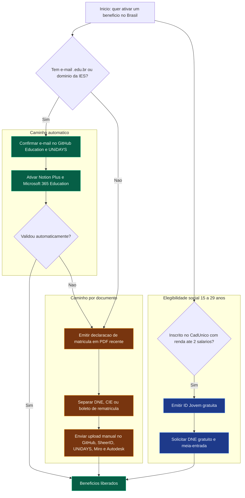

# Como validar status de estudante no Brasil

Muitos estudantes no Brasil perdem benefícios porque algumas plataformas aceitam apenas verificação automática no exterior ou exigem documentos legíveis em português. Este guia resume o que funciona na prática.

## 1. Documentos que destravam quase tudo

- **E-mail institucional:** endereços terminados em `.edu.br` ou domínios reconhecidos de universidades federais, estaduais e privadas (como `@usp.br`, `@unicamp.br`, `@ufsc.br`). Se a sua faculdade não liberou o seu, peça no portal do aluno antes de tentar envio manual.
- **Declaração ou atestado de matrícula em PDF:** precisa mostrar nome completo, nome da instituição, curso, período atual e data de emissão recente (idealmente dos últimos 90 dias).
- **CIE / DNE (Documento Nacional do Estudante):** emitido pela UNE, UBES ou ANPG com QR Code do ITI. Útil tanto para meia-entrada quanto para comprovação visual em análises manuais.
- **Carteirinha da faculdade:** funciona melhor quando exibe validade impressa e nome da instituição por extenso.

### Fluxo de decisão quando sua faculdade não valida de primeira

## 2. Plataformas de verificação usadas no Brasil

### GitHub Education (Student Developer Pack)

- Adicione e confirme seu e-mail institucional nas configurações da sua conta GitHub antes de enviar a solicitação.
- Se a instituição não fornecer e-mail, envie foto ou PDF da declaração de matrícula recente com a câmera ou arquivo nítido.
- Caso o sistema peça localização, faça o pedido conectado na rede habitual e sem VPN ativa.

### SheerID (Gemini, Spotify, YouTube Premium, Perplexity, Grammarly)

- A verificação tenta validar primeiro pelo nome da instituição e pelo e-mail acadêmico.
- Se o banco automático não localizar sua faculdade, o formulário abre upload de documento: envie a **declaração de matrícula oficial** ou **boleto/comprovante de rematrícula** com data visível do semestre corrente.
- Evite prints cortados ou documentos sem data do período letivo.

### UNiDAYS Brasil (Apple Music, Samsung Estudantes, Grammarly)

- Cadastre uma conta pessoal e valide o vínculo acadêmico em [myunidays.com/BR](https://www.myunidays.com/BR).
- Se o portal não aceitar seu e-mail automaticamente, use a opção de suporte/upload de documento acadêmico.
- Depois de aprovado, use o mesmo login UNiDAYS para acessar a loja **Samsung Estudantes** e o desconto do **Apple Music**.

### Goodstack / Atlassian (Asana, Loom)

- Usado em programas educacionais de produtividade. Pede seleção da instituição reconhecida no Brasil e comprovação de matrícula ou domínio acadêmico.

## 3. Cuidados com renovação e cobrança automática

Alguns benefícios exigem cartão de crédito no resgate ou viram assinatura paga depois do período gratuito. Anote lembretes no calendário para não pagar tarifa cheia sem querer:

- **Google Gemini (Google AI Plus):** gratuito por 1 ano para universitários 18+ no Brasil, com janela de resgate até 31/12/2026. Exige cartão no cadastro e passa a cobrar **R$ 24,99/mês** após os 12 meses se não for cancelado.
- **Spotify Universitário, Apple Music Estudante e YouTube Premium:** pedem revalidação anual via SheerID ou UNiDAYS; sem revalidar, migram para a tarifa individual cheia.
- **Namecheap / domínio `.me`:** o primeiro ano é gratuito pelo GitHub Pack, mas a renovação automática do segundo ano tem custo padrão de registro. Desative a renovação automática se não pretende manter o domínio.
- **Adobe Creative Cloud:** o desconto educacional costuma ser maior no primeiro ano e sofre reajuste na renovação anual.
